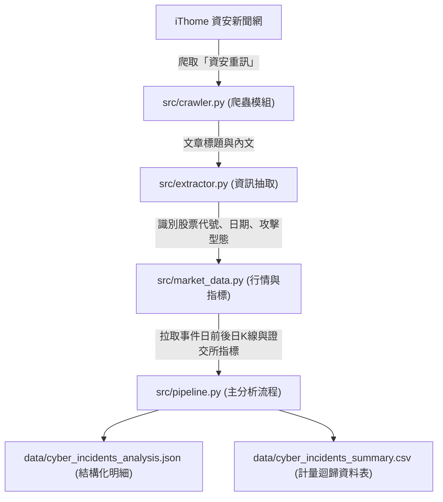

# 上市櫃企業資安事件與股價衝擊分析系統
### Cybersecurity Incident Stock Impact Analysis System

本專案針對臺灣上市、上櫃企業之資安重訊事件，自動化執行新聞爬取、實體與時間軸抽取、台股市場行情比對、異常報酬率（Abnormal Return, AR）與累積異常報酬率（Cumulative Abnormal Return, CAR）計量計算，輸出結構化研究資料集以供事件研究法（Event Study）分析。

---

## 系統架構與資料流 (Architecture & Data Flow)



---

## 專案檔案結構 (Project Structure)

```text
cybersecurity_stock_impact/
├── README.md                      # 專案說明文件
├── requirements.txt               # Python 套件依賴
├── main.py                        # 專案 CLI 執行入口
│
├── src/                           # 核心套件原始碼
│   ├── __init__.py
│   ├── pipeline.py                # 主執行管線 (End-to-End Pipeline)
│   ├── crawler.py                 # iThome 資安重訊爬蟲模組
│   ├── extractor.py               # 實體識別 (NER)、關鍵日期與攻擊類型分類
│   └── market_data.py             # Yahoo Finance 與證交所 OpenAPI 行情評估
│
├── data/                          # 分析成果輸出目錄
│   ├── cyber_incidents_summary.csv    # 事件研究迴歸用 CSV
│   └── cyber_incidents_analysis.json  # 完整結構化事件 JSON
│
├── tests/                         # 單元與整合測試腳本
│   ├── test_ithome.py             # 測試 iThome 網頁爬取
│   ├── test_quote_metrics.py      # 測試股價指標 API
│   ├── test_resolve_tickers.py    # 測試台股股票代號解析 (.TW / .TWO)
│   ├── test_search.py             # 測試關鍵字搜尋匹配
│   └── test_stock_fetch.py        # 測試股價歷史日K線拉取
│
└── scripts/                       # 開發期探索與除錯診斷工具
    ├── check_tags.py              # 檢查 iThome 標籤文章分佈
    ├── crawl_samples.py           # 抓取小規模樣本供比對
    ├── debug_search.py            # 診斷搜尋檢索流程
    ├── explore_announcements.py   # 探索重大訊息文字樣態
    ├── inspect_announcement_details.py # 檢視公告欄位結構
    ├── inspect_article.py         # 檢視單篇文章解析細節
    ├── inspect_patterns.py        # 測試正則抽取正規式
    └── probe_ithome.py            # 探測網站連線健康度
```

---

## 快速開始 (Quick Start)

### 1. 安裝環境需求
建議使用 Python 3.9+，安裝所需套件：
```bash
pip install -r requirements.txt
```

### 2. 執行分析管線
透過根目錄的 `main.py` 即可一鍵執行：
```bash
# 預設爬取最新 2 頁資安重訊 (約 20~30 筆事件)
python main.py

# 指定爬取頁數與輸出目錄
python main.py --pages 5 --output data
```

### 3. 執行測試
```bash
python tests/test_resolve_tickers.py
python tests/test_stock_fetch.py
```

---

## 欄位說明 (Output Dataset Schema)

產出之 `data/cyber_incidents_summary.csv` 包含以下關鍵研究欄位：

| 欄位名稱 | 說明 |
| :--- | :--- |
| `公司名稱` / `股票代碼` | 受駭企業識別與台股代碼 |
| `市場別` | TWSE (上市) 或 TPEx (上櫃) |
| `侵入發生日` / `公開揭露日` | 事發時間與重訊公告時間（衡量資訊外洩與市場反應延遲） |
| `攻擊類型` / `影響範圍` | 攻擊手法（勒索軟體、DDoS、惡意攻擊等）與受損層面 |
| `事件日前收盤` / `事件日收盤` | 揭露日前後基準股價 |
| `次日異常報酬率(AR)` | 事件揭露後第 1 個交易日的超額變動率 |
| `3日累計異常報酬率(CAR)` | 窗口期 [+1, +3] 之累積異常報酬率 |
| `事前外洩檢驗(CAR[-3,-1])` | 揭露前 3 日是否有提早下挫或內線反應跡象 |
| `成交量放大倍數` | 事件日相對於平日均量之爆量程度 |
| `本益比` / `淨值比` / `殖利率` | 台灣證券交易所 / 櫃買中心公開財務比率 |
