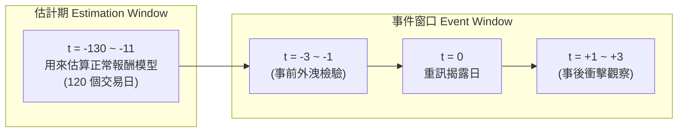
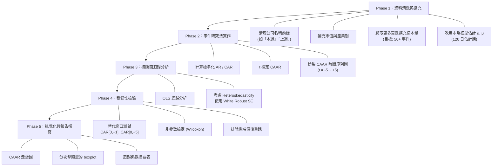

# 資安事件對股價影響之研究設計
## Research Design: The Impact of Cybersecurity Incidents on Stock Prices of Listed Companies in Taiwan

---

## 一、研究動機與問題意識

臺灣自 2023 年起實施上市櫃公司「資安重訊揭露」制度（臺灣證券交易所「上市公司重大訊息之查證暨公開處理程序」），企業遭遇重大資安事件後須即時透過公開資訊觀測站發布重大訊息。這項制度性變革為研究者提供了一個**天然實驗場景**：市場是否能正確反映（price in）資安事件對企業價值的衝擊？

你手上的資料集已涵蓋 **24 起事件（涉及 22 家上市櫃公司）**，時間跨度為 **2026 年 8 月至 10 月**，包含完整的異常報酬率（AR）、累積異常報酬率（CAR）、成交量倍數、攻擊類型等欄位，具備進行嚴謹實證研究的基礎。

---

## 二、研究問題 (Research Questions)

| 編號 | 研究問題 | 對應的統計檢驗 |
| :---: | :--- | :--- |
| **RQ1** | 資安重訊揭露後，受駭企業股價是否出現顯著的負向異常報酬？ | 單一樣本 t 檢定（CAR 是否顯著異於 0） |
| **RQ2** | 不同攻擊類型（勒索軟體 vs. 資料外洩 vs. 撞庫攻擊）的市場衝擊是否有差異？ | 獨立樣本 t 檢定 / ANOVA / Kruskal-Wallis |
| **RQ3** | 哪些企業特徵（市值規模、產業別、財務健全度）會影響衝擊程度？ | 橫斷面 OLS 迴歸 |
| **RQ4** | 事件揭露前是否存在資訊提前外洩（Information Leakage）的跡象？ | CAR[-3, -1] 是否顯著異於 0 |

---

## 三、核心研究方法：事件研究法 (Event Study Methodology)

### 3.1 方法論概述

**事件研究法（Event Study）** 是財務經濟學中衡量特定事件對證券價格影響的標準方法，最早由 Fama, Fisher, Jensen, and Roll (1969) 建立框架。其核心邏輯是：

> 如果市場是有效率的，事件所帶來的經濟影響應反映在事件日附近的股價變動上。我們透過計算「異常報酬」（Abnormal Return），也就是實際報酬與「假設不發生事件時的預期報酬」之差額，來量化事件的衝擊。



### 3.2 關鍵時間軸定義

| 期間 | 交易日範圍 | 用途 |
| :--- | :--- | :--- |
| **估計期 (Estimation Window)** | t = -130 至 t = -11 | 以 120 個交易日估算「正常報酬」市場模型參數 (α, β) |
| **事前窗口 (Pre-Event Window)** | t = -3 至 t = -1 | 檢驗事件消息是否在正式公告前提前外洩 |
| **事件日 (Event Day)** | t = 0 | 重大訊息揭露日（公開資訊觀測站公告日） |
| **事後窗口 (Post-Event Window)** | t = +1 至 t = +3 / +5 | 衡量市場消化事件資訊的反應幅度與速度 |

### 3.3 異常報酬的計算步驟

**Step 1：以市場模型 (Market Model) 估計正常報酬**

在估計期內，對每支個股跑以下 OLS 迴歸，估計其與大盤的關聯：

$$R_{i,t} = \alpha_i + \beta_i \cdot R_{m,t} + \varepsilon_{i,t}$$

- $R_{i,t}$：個股 i 在第 t 日的實際日報酬率
- $R_{m,t}$：臺灣加權指數（^TWII）在第 t 日的日報酬率
- $\alpha_i, \beta_i$：估計期間的 OLS 估計參數

**Step 2：計算事件窗口期的異常報酬 (Abnormal Return, AR)**

$$AR_{i,t} = R_{i,t} - (\hat{\alpha}_i + \hat{\beta}_i \cdot R_{m,t})$$

> [!NOTE]
> 你目前的程式碼 [market_data.py](file:///c:/Users/joseph/Desktop/IR/cybersecurity_stock_impact/src/market_data.py#L189-L207) 使用的是**市場調整模型 (Market-Adjusted Model)**，即直接以 `個股報酬 - 大盤報酬` 計算 AR。這是簡化版做法，假設所有股票的 β = 1。若要做學術論文等級的研究，建議改用完整的市場模型（估計每支股票各自的 α 和 β）。

**Step 3：累積異常報酬 (Cumulative Abnormal Return, CAR)**

$$CAR_i(t_1, t_2) = \sum_{t=t_1}^{t_2} AR_{i,t}$$

常用的 CAR 窗口包括：
- `CAR[0, +1]`：事件日與次日的即時反應
- `CAR[0, +3]`：短期（3 個交易日）累積衝擊
- `CAR[-1, +1]`：包含事件日前一天的窗口（捕捉盤後公告的效果）
- `CAR[-3, -1]`：事前窗口（檢驗資訊外洩）

**Step 4：跨事件的平均異常報酬 (CAAR) 與統計檢定**

$$CAAR(t_1, t_2) = \frac{1}{N} \sum_{i=1}^{N} CAR_i(t_1, t_2)$$

透過 **t 檢定** 檢驗 CAAR 是否顯著異於 0：

$$t_{CAAR} = \frac{CAAR}{\sigma(CAR) / \sqrt{N}}$$

---

## 四、你的資料集現況分析與變數規劃

### 4.1 現有資料盤點

根據 [cyber_incidents_summary.csv](file:///c:/Users/joseph/Desktop/IR/cybersecurity_stock_impact/data/cyber_incidents_summary.csv) 的 24 筆事件，我整理出以下資料分布：

**攻擊類型分布：**
| 攻擊類型 | 事件數 | 佔比 |
| :--- | :---: | :---: |
| 資料外洩 (Data Breach) | 18 | 75% |
| 未授權存取/入侵 | 10 | 42% |
| 自動化帳密攻擊 (Credential Stuffing) | 5 | 21% |
| 勒索軟體 (Ransomware) | 4 | 17% |
| 第三方/供應鏈事故 | 3 | 13% |
| 一般網路安全事故 | 2 | 8% |

> [!IMPORTANT]
> 多數事件包含多重攻擊類型（如「資料外洩 / 未授權存取」），在迴歸分析中建議以**虛擬變數（Dummy Variable）** 方式處理，而非互斥分類。

**市場別分布：**
| 市場別 | 事件數 |
| :--- | :---: |
| TPEx 上櫃 | 14 |
| TWSE 上市 | 9 |
| 未知 | 1 |

### 4.2 應變數 (Dependent Variables)

| 變數名稱 | 定義 | 已有欄位 |
| :--- | :--- | :---: |
| `AR_1d` | 事件日次日異常報酬率 | ✅ `次日異常報酬率(AR)` |
| `CAR_3d` | 事件日後 3 日累積異常報酬率 | ✅ `3日累計異常報酬率(CAR)` |
| `Volume_Shock` | 事件日成交量相對事前均量的倍數 | ✅ `成交量放大倍數` |

### 4.3 自變數 / 解釋變數 (Independent Variables)

| 變數名稱 | 類型 | 定義 | 資料來源 |
| :--- | :---: | :--- | :--- |
| `D_Ransomware` | 虛擬 (0/1) | 是否涉及勒索軟體 | ✅ 已有 `攻擊類型` |
| `D_DataBreach` | 虛擬 (0/1) | 是否涉及個資外洩 | ✅ 已有 |
| `D_CredentialStuffing` | 虛擬 (0/1) | 是否涉及帳密撞庫 | ✅ 已有 |
| `D_SupplyChain` | 虛擬 (0/1) | 是否為第三方/供應鏈事故 | ✅ 已有 |
| `D_ERP_Down` | 虛擬 (0/1) | 是否導致核心系統停擺 | ✅ 已有 `影響範圍` |
| `D_CustomerData` | 虛擬 (0/1) | 是否涉及顧客個資外洩 | ✅ 已有 |
| `PE_Ratio` | 連續 | 本益比（衡量估值高低） | ✅ 已有 |
| `PB_Ratio` | 連續 | 淨值比（衡量市場溢價程度） | ✅ 已有 |
| `Dividend_Yield` | 連續 | 殖利率（衡量投資人結構） | ✅ 已有 |
| `D_TWSE` | 虛擬 (0/1) | 是否為上市公司（vs. 上櫃） | ✅ 已有 `市場別` |
| `Disclosure_Lag` | 連續 | 侵入日至公開揭露日的時間差（天數） | ✅ 可從 `侵入發生日`、`公開揭露日` 計算 |

### 4.4 建議新增 / 需補充的變數

| 變數名稱 | 類型 | 定義 | 建議資料來源 |
| :--- | :---: | :--- | :--- |
| `Market_Cap` | 連續 | 事件日前一日的市值（億元）| Yahoo Finance API / 證交所 |
| `Industry` | 類別 | 產業別（電子 vs. 傳產 vs. 金融 vs. 服務） | 證交所產業分類 |
| `D_Repeat` | 虛擬 (0/1) | 該公司是否為「累犯」（資料期間內多次資安事件） | 從資料集中辨識（如鈊象 3293 出現 2 次） |
| `CAR_pre` | 連續 | 事前外洩檢驗 CAR[-3, -1] | ✅ 已有 |

---

## 五、迴歸模型設計 (Regression Models)

### Model 1：整體事件衝擊檢定（核心發現）

> **假說 H₁：** 資安重訊揭露後，受駭企業的 CAR 顯著為負。

```
統計方法：單一樣本 t 檢定
H₀: CAAR[0, +3] = 0
H₁: CAAR[0, +3] < 0 （單尾檢定）
```

### Model 2：攻擊類型對衝擊程度的影響

> **假說 H₂：** 勒索軟體攻擊造成的股價衝擊顯著大於資料外洩事件。

```
CAR_3d_i = β₀ + β₁·D_Ransomware + β₂·D_CredentialStuffing 
         + β₃·D_SupplyChain + β₄·D_ERP_Down + ε_i

（基準組 = 資料外洩 Data Breach）
```

### Model 3：企業特徵對衝擊的調節效果

> **假說 H₃：** 高本益比（高市場估值）企業受到的衝擊更大（投資人期望高，失望也大）。

```
CAR_3d_i = β₀ + β₁·D_Ransomware + β₂·D_ERP_Down 
         + β₃·ln(Market_Cap) + β₄·PE_Ratio + β₅·PB_Ratio
         + β₆·D_TWSE + β₇·Disclosure_Lag + ε_i
```

### Model 4：資訊外洩檢驗

> **假說 H₄：** 在重訊正式揭露前，市場已出現異常下跌（資訊外洩）。

```
統計方法：單一樣本 t 檢定
H₀: CAAR[-3, -1] = 0
H₁: CAAR[-3, -1] < 0
```

---

## 六、預期結果與假說方向

### 6.1 根據你現有資料的初步觀察

基於 [cyber_incidents_summary.csv](file:///c:/Users/joseph/Desktop/IR/cybersecurity_stock_impact/data/cyber_incidents_summary.csv) 的 24 筆資料，初步描述性統計顯示：

| 指標 | 數值觀察 | 初步解讀 |
| :--- | :--- | :--- |
| **次日 AR 中位數** | 約 -0.2% ~ 0% | 衝擊偏溫和，多數在一個交易日內不顯著 |
| **極端負面案例** | 貿聯(3665) AR = -8.87%, CAR = -13.22% | 少數事件衝擊劇烈，影響整體平均 |
| **極端正面案例** | 鈊象(3293) AR = +3.19%, 富爾特(6136) AR = +2.96% | 部分事件反而逆勢上漲（可能因事前已超跌或利空出盡） |
| **成交量倍數** | 多數在 0.5x ~ 1.7x | 並非每起事件都引發恐慌性拋售 |
| **事前 CAR[-3,-1]** | 崴寶(7744) = -6.05%、鈊象(3293)第一次 = +4.68% | 部分事件事前有異常波動，值得個別分析 |

### 6.2 我預期你研究會發現的結果

> [!TIP]
> 以下是基於國際文獻 + 你的資料初步觀察所做的合理推測。最終結果需以統計檢驗為準。

**預期結果 1（RQ1 - 整體衝擊）：**
- **整體 CAAR[0, +3] 可能呈現統計上不顯著的微弱負值（約 -1% ~ -2%）**
- 原因：臺灣上市櫃公司資安事件以資料外洩為主（75%），且幾乎所有公司的官方聲明均為「初步評估無重大影響」，市場可能已對這類公式化聲明脫敏
- 但若排除「利空出盡反彈」案例後，負面衝擊可能更明顯

**預期結果 2（RQ2 - 攻擊類型差異）：**
- **勒索軟體事件的衝擊可能大於單純資料外洩**（β₁ 為負且顯著）
- 理由：勒索軟體影響核心系統（ERP 停擺），直接衝擊企業營運能力，屬於「看得見的損害」
- 你的資料中，崴寶（Ransomware, AR = -2.62%）、貿聯（General Incident, AR = -8.87%）均有明顯負面反應

**預期結果 3（RQ3 - 企業特徵調節）：**
- **高估值企業（高 PB、高 PE）可能遭受更大衝擊**
- 如貿聯（PB = 7.93, PE = 37.00, CAR = -13.22%）vs. 上福（PB = 0.87, CAR = +0.78%）
- **上市 vs. 上櫃可能無顯著差異**（兩類市場皆適用同一重訊揭露制度）

**預期結果 4（RQ4 - 資訊外洩）：**
- **整體 CAAR[-3, -1] 可能接近零且不顯著**
- 臺灣重訊制度要求即時揭露，且多數事件的侵入日與揭露日為同一天（你的資料中 24 筆有 21 筆相同），留給內線交易的時間窗口很短
- 但個別案例值得關注：崴寶事前 CAR[-3,-1] = -6.05%，可能有消息提前走漏

---

## 七、實作流程建議與下一步



### 立即可做的下一步：

1. **擴充資料量**：將 `max_pages` 設為更大值（如 5~10），取得 50+ 筆事件以提升統計檢力
2. **改進 AR 計算**：在 [market_data.py](file:///c:/Users/joseph/Desktop/IR/cybersecurity_stock_impact/src/market_data.py) 中加入 120 日估計期的 OLS 迴歸（市場模型），取代目前的直接相減
3. **建立分析腳本**：撰寫 Python 統計分析腳本（使用 `statsmodels` 或 `scipy`），一鍵執行所有假說檢定
4. **資料清理**：處理公司名稱前綴不一致（如「本週遊戲軟體公司鈊象」vs.「遊戲軟體公司鈊象」）

---

## 八、參考文獻

| 作者 | 論文 | 重要性 |
| :--- | :--- | :--- |
| Campbell et al. (2003) | "The Economic Cost of Publicly Announced Information Security Breaches" | 資安事件對股價影響的開創性研究，發現涉及機密資訊的資安事件導致顯著負面市場反應 |
| Cavusoglu et al. (2004) | "The Effect of Internet Security Breach Announcements on Market Value" | 發現公告日平均 AR 約 -2.1%，且攻擊類型為重要調節變數 |
| Goel & Shawky (2009) | "Estimating the Market Impact of Security Breach Announcements on Firm Values" | 區分了 DoS 攻擊與資料竊取的差異性衝擊 |
| MacKinlay (1997) | "Event Studies in Economics and Finance" | 事件研究法的標準方法論教科書文獻 |

> [!WARNING]
> **樣本量注意**：目前 24 筆事件的統計檢力（Statistical Power）有限，尤其在進行子群比較（如勒索軟體 vs. 資料外洩，僅 4 vs. 18 筆）時，p 值可能偏高。建議：(1) 擴充爬取頁數增加樣本；(2) 使用非參數檢定（Wilcoxon Signed-Rank Test）作為穩健性檢驗；(3) 在論文中誠實報告樣本量的限制。
